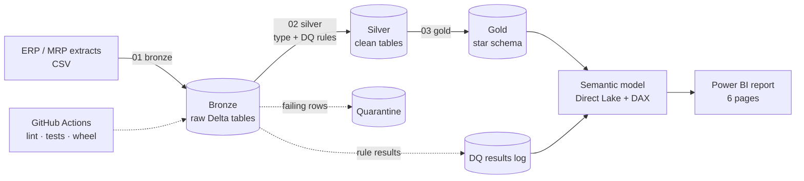

# Manufacturing Operations Intelligence

An end-to-end BI solution for a fictional precision-valve manufacturer, **Nordhalde Precision AG** (three plants: Switzerland, Malaysia, Romania). It runs from ERP/MRP source extracts through a lakehouse with built-in data-quality controls to a Power BI semantic model, with automated tests and CI/CD.

All data is synthetic and generated by this repository. The company is invented.

## What it shows

| Area | Implementation |
|---|---|
| Data lake / lakehouse | Medallion architecture (bronze → silver → gold) on Microsoft Fabric Lakehouse, Delta tables |
| Data pipelines & orchestration | PySpark notebooks run in sequence by a Fabric Data Pipeline |
| Data quality | 11 declarative rules (completeness, validity, consistency, uniqueness, integrity). Failing rows go to quarantine tables, and every run is logged |
| Semantic modelling | Star schema with 4 fact and 6 dimension tables, Direct Lake, 25+ DAX measures |
| ERP / MRP | SAP-style material types (FERT, HALB, ROH), bills of material, production orders, safety stock, dependent demand |
| Version control & CI/CD | Git, GitHub Actions: lint, end-to-end tests and a wheel build on every push |
| Stakeholder enablement | KPI guide in English and German: definition, formula, how to read it, what to do |

## Architecture



## Data-quality rules

| Rule | Table | Check | Severity |
|---|---|---|---|
| SO-01 | sales_orders | Customer exists in customer master | error |
| SO-02 | sales_orders | Order quantity is positive | error |
| SO-03 | sales_orders | Requested delivery date is filled | error |
| SO-04 | sales_orders | Requested date is not before order date | warning |
| PR-01 | production_orders | Production order ID is unique | error |
| PR-02 | production_orders | Actual finish is not before actual start | error |
| PR-03 | production_orders | Good + scrap quantity at most 150% of plan | error |
| PR-04 | production_orders | Work centre belongs to the same plant | warning |
| IN-01 | inventory_snapshots | Stock on hand is not negative | error |
| DL-01 | deliveries | Delivery refers to an existing order line | error |
| PU-01 | purchase_orders | Goods receipt is not before the order date | warning |

The generator plants a known number of each defect. The tests assert that every planted defect is caught, that bronze rows = silver + quarantine rows, and that gold reconciles to silver.

## Gold tables

`dim_date`, `dim_plant`, `dim_material`, `dim_customer`, `dim_supplier`, `dim_work_center`, `fact_sales_order_line`, `fact_production_order`, `fact_inventory_snapshot`, `fact_purchase_order`, `dq_results`

## Run it locally

Requirements: Python 3.10+, Java 17.

```bash
pip install -e ".[dev]"
python -m mfgops.run_local     # generate data, run bronze, silver, gold, print DQ results
pytest -q                      # 14 tests, about 30 seconds
```

## Deploy to Microsoft Fabric

See [docs/fabric-setup.md](docs/fabric-setup.md).

## Repository layout

```
src/mfgops/        generate.py · lakehouse.py · quality.py · pipeline.py · run_local.py
notebooks/         Fabric notebooks 00–03 (thin wrappers around the package)
semantic-model/    measures.dax · model.md (relationships, modelling choices, report pages)
docs/              fabric-setup.md · kpi-guide-en.md · kpi-leitfaden-de.md
tests/             end-to-end pipeline and data-quality tests
.github/workflows/ CI pipeline
```

## Author

Alexander Burblis · [LinkedIn](https://linkedin.com/in/alexanderburblis) · related project: [Sentavo Treasury Control Tower](https://github.com/alexanderburblis/sentavo-treasury-dashboard)
