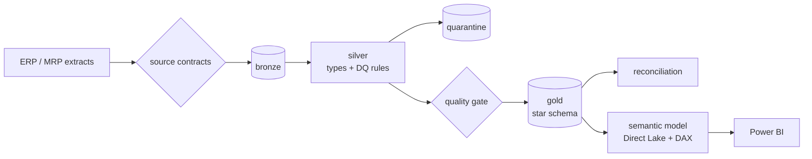

# Manufacturing Operations Intelligence

An end-to-end BI data platform for a fictional precision-valve manufacturer, **Nordhalde Precision AG** (three plants: Switzerland, Malaysia, Romania). ERP/MRP extracts go through validated ingestion, a PySpark lakehouse with a data-quality framework and a quality gate, then into a star schema for Power BI, with automated tests and CI/CD.

All data is synthetic and generated by this repository. The company is invented and does not represent any real company.

## Status

| Done, tested and running in CI | Deployed in Microsoft Fabric | Planned |
|---|---|---|
| Source contracts, row-count monitoring, bronze / silver / gold, column profiling, 25 data-quality rules with owners and corrective actions, quarantine, quality gate, reconciliation, run log, 20 tests, GitHub Actions | Lakehouse with Delta tables, orchestrated notebook run, Data Pipeline `pl_mfg_ops_daily`, Direct Lake semantic model with 14 relationships and 22 measures | Power BI report pages, Fabric Git integration, budget alerting |

The detailed status per capability is in [docs/architecture.md](docs/architecture.md).

## The central demonstration: a bad extract is caught, fixed and reprocessed

```bash
python -m mfgops.demo_dq
```

1. A clean run goes green.
2. The next sales-order extract arrives with an unknown plant code on 5% of lines.
3. Rule SO-05 fails, and the **quality gate stops the run before gold is refreshed**, so the report keeps the last good data.
4. Diagnostics show each failing rule with its owner and corrective action, plus the quarantined rows.
5. The extract is corrected and resent.
6. The rerun passes the gate, gold is refreshed and all five reconciliation checks pass.

Bonus: an extract with a missing column fails at source validation, before anything is loaded. The full output of one run is in [docs/evidence/dq-demo-run.txt](docs/evidence/dq-demo-run.txt).

## Architecture



Stages, the local ↔ Fabric mapping and what is and is not deployed: [docs/architecture.md](docs/architecture.md). Design choices (lakehouse vs warehouse, PySpark vs SQL vs pandas, gate placement): [docs/decisions](docs/decisions/README.md).

## What it covers

| Area | Implementation |
|---|---|
| Ingestion | Source contracts (file, exact columns, not empty), load timestamps, row-count monitoring against the last good run, column profiling |
| Lakehouse | Bronze (raw text), silver (typed, checked), gold (star schema). Parquet locally, Delta in Fabric |
| Data quality | 25 rules across completeness, validity, consistency, uniqueness, integrity and data types ([list](docs/data-quality-rules.md)). Each has an owner and a corrective action. Failing rows are quarantined. Every run is logged |
| Orchestration | Eight stages with logging, retries with backoff, failure stop and a quality gate (`src/mfgops/orchestrate.py`) |
| Reconciliation | Silver vs gold totals, and OTIF and scrap rate recalculated in Spark SQL from silver, independently of the gold logic |
| Semantic model | 4 facts, 6 dimensions, grain documented, 26 DAX measures ([model](semantic-model/model.md), [measures](semantic-model/measures.dax), [data dictionary](docs/data-dictionary.md)) |
| ERP / MRP | SAP-style material types (FERT, HALB, ROH), bills of material, production orders, safety stock, dependent demand for days of coverage |
| CI/CD | GitHub Actions on every push: ruff lint, 20 tests including full pipeline runs, wheel build for the Fabric Environment |
| Users | KPI guide in [English](docs/kpi-guide-en.md) and [German](docs/kpi-leitfaden-de.md): definition, formula, how to read it, what to do |

## Run it locally

Requirements: Python 3.10+, Java 17.

```bash
pip install -e ".[dev]"
python -m mfgops.run_local     # generate data and run all eight stages
python -m mfgops.demo_dq       # the data-quality demonstration
pytest -q                      # 20 tests, about 90 seconds
```

The gold tables of a seed-42 run are also in [`sample-data/gold`](sample-data/gold) as CSV, so the Power BI model can be built without running Spark.

## Deploy to Microsoft Fabric

[docs/fabric-setup.md](docs/fabric-setup.md)

## Repository layout

```
src/mfgops/        generate · ingest · quality · pipeline · reconcile · orchestrate · demo_dq · lakehouse
notebooks/         Fabric notebooks 00–04 (thin wrappers around the package)
semantic-model/    measures.dax · model.md
docs/              architecture · decisions · data-quality-rules · data-dictionary · fabric-setup
                   kpi guides (EN/DE) · interview-demo-guide · evidence/
sample-data/gold/  gold tables as CSV (generated, seed 42)
tests/             pipeline, data-quality and orchestration tests
tools/             notebook and documentation generators
```

## Author

Alexander Burblis · [LinkedIn](https://linkedin.com/in/alexanderburblis) · related project: [Sentavo Treasury Control Tower](https://github.com/alexanderburblis/sentavo-treasury-dashboard)
