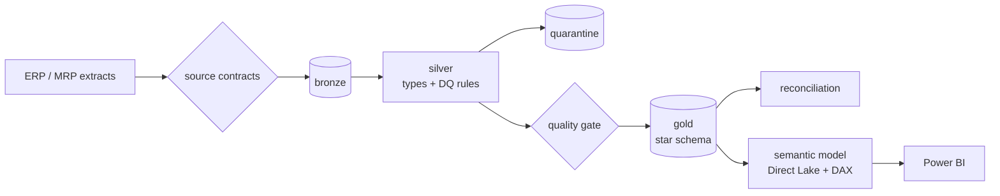

# Manufacturing Operations Intelligence

An end-to-end BI data platform for a fictional precision-valve manufacturer, **Nordhalde Precision AG** (three plants: Switzerland, Malaysia, Romania). Extracts shaped like Microsoft Dynamics 365 data entities go through validated ingestion, a PySpark lakehouse in Microsoft Fabric with a data-quality framework, a quality gate and incremental loading, into a Direct Lake semantic model and a nine-page Power BI report, all deployed from code and tested on every push.

All data is synthetic and generated by this repository. The company is invented and does not represent any real company.

## Status

| Done, tested and running in CI | Deployed in Microsoft Fabric | Planned |
|---|---|---|
| D365-shaped source extracts with a documented mapping layer, source contracts, row-count monitoring, bronze / silver / gold, column profiling, 25 data-quality rules with owners and corrective actions, quarantine, quality gate, reconciliation, incremental load (watermark, MERGE, idempotent rerun), customer history (SCD type 2), run log and run summary, semantic model and report as code, 36 tests, GitHub Actions | Lakehouse with Delta tables, orchestrated notebook (full and incremental mode), Data Pipeline `pl_mfg_ops_daily`, Direct Lake semantic model | See [docs/architecture.md](docs/architecture.md) for what runs where |

## The central demonstration: a bad extract is caught, fixed and reprocessed

```bash
python -m mfgops.demo_dq
```

1. A clean run goes green.
2. The next sales-order extract arrives with an unknown plant code on 5% of lines.
3. Rule SO-05 fails, and the **quality gate stops the run before gold is refreshed**, so the report keeps the last good data.
4. Diagnostics show each failing rule with its owner and corrective action, plus the quarantined rows.
5. The extract is corrected and resent.
6. The rerun passes the gate, gold is refreshed and all five reconciliation checks pass.

Bonus: an extract with a missing column fails at source validation, before anything is loaded. The full output of one run is in [docs/evidence/dq-demo-run.txt](docs/evidence/dq-demo-run.txt).

## Architecture



Stages, the local ↔ Fabric mapping and what is and is not deployed: [docs/architecture.md](docs/architecture.md). Design choices (lakehouse vs warehouse, PySpark vs SQL vs pandas, gate placement): [docs/decisions](docs/decisions/README.md).

## What it covers

| Area | Implementation |
|---|---|
| Source system | Extracts follow Dynamics 365 data entity and field names (SalesOrderLinesV2, ProductionOrderHeaders, CustomersV3 …), mapped to the model in one place ([source mapping](docs/source-mapping.md)) |
| Ingestion | Source contracts (file, exact columns, not empty), load timestamps, row-count monitoring against the last good run, column profiling |
| Incremental load | `ModifiedDateTime` watermark, change extract appended to bronze, MERGE into silver by business key, watermark moved only after a successful run, customer history as SCD type 2 ([evidence](docs/evidence/full-and-incremental-run.txt)) |
| Lakehouse | Bronze (raw text), silver (typed, checked), gold (star schema). Parquet locally, Delta in Fabric |
| Data quality | 25 rules across completeness, validity, consistency, uniqueness, integrity and data types ([list](docs/data-quality-rules.md)). Each has an owner and a corrective action. Failing rows are quarantined. Every run is logged |
| Orchestration | Eight stages with logging, retries with backoff, failure stop and a quality gate (`src/mfgops/orchestrate.py`) |
| Reconciliation | Silver vs gold totals, and OTIF and scrap rate recalculated in Spark SQL from silver, independently of the gold logic |
| Semantic model | Direct Lake, 4 facts, 6 dimensions, versioned customer key, 16 relationships, 43 measures, row-level security by plant, defined as code in `model_def.py` ([data dictionary](docs/data-dictionary.md)) |
| Report | Nine pages: overview, delivery, production, inventory, purchasing, data quality, pipeline runs, drill-through to customer orders and to work-centre orders. PBIR defined in `report_def.py`, validated against Microsoft's PBIR schemas, deployed through the Fabric REST API (`deploy.py`) |
| Requirements | Example specification from business request to acceptance tests: [OTIF by customer](docs/requirements-spec-otif-by-customer.md) |
| ERP / MRP | Item categories (finished, semi-finished, raw), bills of material, production orders with D365 statuses, safety stock, dependent demand for days of coverage |
| CI/CD | GitHub Actions on every push: ruff lint, 36 tests (full and incremental pipeline runs, SCD2, model–report consistency), wheel build |
| Users | KPI guide in [English](docs/kpi-guide-en.md) and [German](docs/kpi-leitfaden-de.md): definition, formula, how to read it, what to do |

## Run it locally

Requirements: Python 3.10+, Java 17.

```bash
pip install -e ".[dev]"
python -m mfgops.run_local --with-increment   # full load, then the 15 Nov change extract
python -m mfgops.demo_dq                      # the data-quality demonstration
pytest -q                                     # 36 tests, about 3 minutes
python tools/build_fabric_items.py            # write the model (TMDL) and report (PBIR) to fabric/
```

The gold tables of a seed-42 run are also in [`sample-data/gold`](sample-data/gold) as CSV, so the Power BI model can be built without running Spark.

## Deploy to Microsoft Fabric

[docs/fabric-setup.md](docs/fabric-setup.md)

## Repository layout

```
src/mfgops/        generate · source_map · ingest · quality · pipeline · reconcile · orchestrate · demo_dq
                   lakehouse · model_def · report_def · deploy
notebooks/         Fabric notebooks 00–06 (thin wrappers around the package)
semantic-model/    earlier hand-written DAX and TMDL (superseded by model_def.py)
docs/              architecture · decisions · source-mapping · requirements spec · data-quality-rules
                   data-dictionary · fabric-setup
                   kpi guides (EN/DE) · interview-demo-guide · evidence/
sample-data/gold/  gold tables as CSV (generated, seed 42)
tests/             pipeline, data-quality, orchestration, incremental and Fabric-item tests
tools/             notebook, documentation and Fabric item generators
```

## Author

Alexander Burblis · [LinkedIn](https://linkedin.com/in/alexanderburblis) · related project: [Sentavo Treasury Control Tower](https://github.com/alexanderburblis/sentavo-treasury-dashboard)
