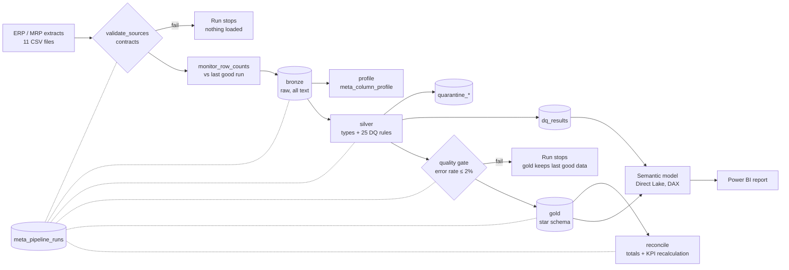

# Architecture

## Data flow

Every stage writes its status, timing, row count and message to `meta_pipeline_runs`.

## What is implemented, tested and deployed

Deployed on 25 November 2026 to a Microsoft Fabric workspace (`mfg-ops-intelligence`, F2 capacity, Switzerland North).

| Capability | Implemented | Tested automatically | Runs in Fabric |
|---|---|---|---|
| Synthetic ERP/MRP source data with planted defects | yes | yes | yes, written to `Files/raw` of `lh_mfg_ops` |
| Source contracts and schema validation | yes | yes (missing column test) | yes |
| Row-count monitoring against last good run | yes | yes (unit test) | yes |
| Bronze / silver / gold in PySpark | yes | yes | yes, as Delta tables |
| Column profiling (`meta_column_profile`) | yes | indirectly | yes |
| 25 data-quality rules with owner and corrective action | yes | yes (every planted defect caught) | yes, 121 rows quarantined, 8 rules failing |
| Quarantine tables | yes | yes | yes |
| Quality gate protecting gold | yes | yes (gold unchanged after a bad run) | yes |
| Retries with backoff for transient errors | yes | no (needs a flaky dependency to test) | yes, plus activity retries in the Data Pipeline |
| Reconciliation: silver vs gold totals, KPI recalculation | yes | yes | yes, 5 of 5 passed |
| CI: lint, tests, wheel build on every push | yes | runs on GitHub | n/a |
| Orchestration | `orchestrate.py` | yes | Data Pipeline `pl_mfg_ops_daily` running notebook `nb_04_orchestrated_run`; pipeline run on 25 Nov 2026 succeeded in 24 min 50 s (includes Spark session start and package install on F2) |
| Incremental load (watermark, MERGE by business key, idempotent rerun) | yes | yes (8 tests, including rerun and SCD2) | yes, change extract of 15 Nov: 1,664 rows inserted, 188 updated, 2 quarantined, Delta `MERGE` |
| Customer history (SCD type 2) | yes | yes | yes, `silver_customers_history`, sales joined to the customer version valid at order date |
| Run summary (`meta_run_summary`, one row per run, failed runs included) | yes | yes | yes, 4 runs: full success, 2 failed incremental runs, incremental success |
| Semantic model | 14 tables, 16 relationships, 43 measures, 2 roles, defined in `model_def.py` | yes (model–report field consistency, placeholders, deploy calls) | yes, Direct Lake model `sm_mfg_ops`, deployed through the Fabric REST API by notebook `06_deploy_model_and_report` |
| Row-level security by plant | yes, roles *Plant access* (dynamic, `USERPRINCIPALNAME()`) and *All plants* | yes (role definitions) | roles deployed; filter checked per user by DAX query ([evidence](evidence/rls-check.md)). *Test as role* is not available with SSO, see the evidence file |
| Power BI report | 9 pages incl. 2 drill-throughs, PBIR in `report_def.py`, validated against Microsoft's PBIR JSON schemas | yes | yes, `rpt_mfg_ops` ([screenshots](../README.md#the-report-in-microsoft-fabric)) |
| Failure alert from the Data Pipeline | planned | – | not yet: the notebook raises on a failed run, so the pipeline run fails and shows in the monitoring hub, but no e-mail is sent yet |
| Fabric Git integration, deployment pipeline dev → prod | planned | – | not yet |

Fabric results after the full load and the incremental load: revenue CHF 1.82bn, OTIF 75.7%, scrap rate 3.25%, schedule adherence 57.0%, stock value CHF 61.92M, supplier on-time 70.0%, data-quality pass rate 99.97% on the latest run. Stage timings of the first full run on F2: validate 9 s, bronze 91 s, profile 22 s, silver 217 s, gold 108 s, reconcile 7 s.

## What went wrong in the first Fabric runs

Two problems that the local tests did not catch, and how they were fixed:

1. **The first two incremental runs failed** at the silver stage with `DELTA_MISSING_DELTA_TABLE: silver_sales_orders is not a Delta table`. The reconciliation step registered Spark temporary views named like the lakehouse tables. In a Fabric notebook those views survive a Python kernel restart (they live in the Spark session, not in Python), so the next run's `MERGE` resolved `silver_sales_orders` to a view instead of the Delta table. Fix: views get an `rc_` prefix and are dropped in a `finally` block, and a test checks that no temporary views remain after a run. Both failed runs are kept in `meta_run_summary` and are visible on the *Pipeline runs* report page; the watermark was not moved by them, so the third run reprocessed the same change extract correctly.
2. **The first report import was rejected** (`definition.pbir: required properties are missing in byConnection`). The PBIR schema accepts a short connection, the Fabric import API does not. Fix: the full live connection (`connectionString`, `pbiServiceModelId`, `pbiModelVirtualServerName`, `pbiModelDatabaseName`, `name`, `connectionType`), with a test that checks it.

Local execution proves the logic, and the Fabric deployment shows it runs on the platform. It is still a portfolio deployment, not a production one: one F2 capacity, one workspace, fictional users, no deployment pipeline between environments and no failure alert yet. Those are listed under *Production next steps* below.

## Local and Microsoft Fabric mapping

| Concern | Local | Microsoft Fabric | Azure equivalent outside Fabric |
|---|---|---|---|
| Raw file landing | `data/raw/*.csv` | Lakehouse `Files/raw` (OneLake) | ADLS Gen2 container |
| Table storage | Parquet folders under `lakehouse/` | Delta tables in the Lakehouse | Delta on ADLS Gen2 (Databricks / Synapse) |
| Compute | Spark `local[2]` | Fabric Spark pool (notebooks) | Databricks, Synapse Spark |
| Orchestration | `python -m mfgops.orchestrate` | Data Pipeline → notebook `04_orchestrated_run`, schedule, failure path | Azure Data Factory |
| Run history | `meta_pipeline_runs` | same table, plus the Fabric monitoring hub | ADF monitor, Log Analytics |
| Semantic model | `semantic-model/` definitions | Direct Lake semantic model on the gold tables | Power BI import or DirectQuery |
| Code deployment | `pip install -e .` | Wheel from CI uploaded to a Fabric Environment | Wheel to a cluster library |
| Version control | Git, GitHub Actions | Fabric Git integration for workspace items | Azure DevOps or GitHub |

The package is the same in both places. `Lakehouse.detect()` switches between Parquet paths and Delta tables, so no transformation code changes between local and Fabric.

## Production next steps

- Alerting: an on-failure activity in `pl_mfg_ops_daily` that sends an e-mail or Teams message with the run ID, failed stage and message from `meta_run_summary`.
- Environment promotion: Fabric Git integration for the workspace and a deployment pipeline (dev → prod), with deployment rules that point the production model at the production lakehouse.
- Access: Entra ID groups in the RLS roles, a fixed-identity connection for the Direct Lake model so roles can be tested as a user, workspace roles per audience.
- Real source: replace the synthetic extracts with D365 data entities exported to the lakehouse (for example through Synapse Link / Fabric Link); the mapping layer in `source_map.py` is the only place that changes.
