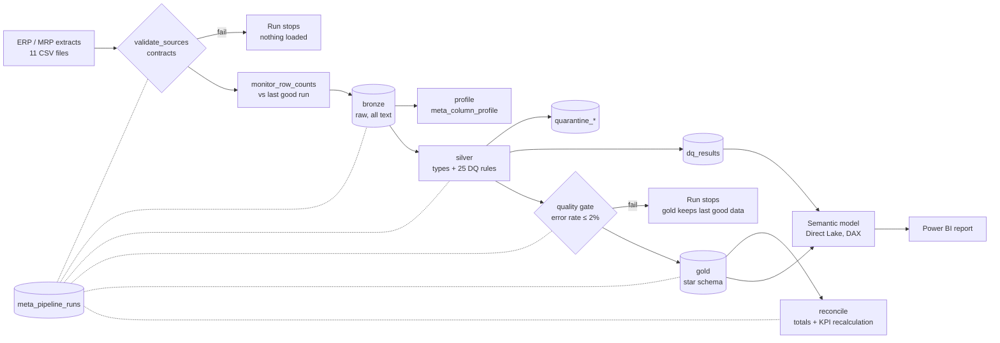

# Architecture

## Data flow

Every stage writes its status, timing, row count and message to `meta_pipeline_runs`.

## What is implemented, tested and deployed

Deployed on 25 November 2026 to a Microsoft Fabric workspace (`mfg-ops-intelligence`, F2 capacity, Switzerland North).

| Capability | Implemented | Tested automatically | Runs in Fabric |
|---|---|---|---|
| Synthetic ERP/MRP source data with planted defects | yes | yes | yes, written to `Files/raw` of `lh_mfg_ops` |
| Source contracts and schema validation | yes | yes (missing column test) | yes |
| Row-count monitoring against last good run | yes | yes (unit test) | yes |
| Bronze / silver / gold in PySpark | yes | yes | yes, as Delta tables |
| Column profiling (`meta_column_profile`) | yes | indirectly | yes |
| 25 data-quality rules with owner and corrective action | yes | yes (every planted defect caught) | yes, 121 rows quarantined, 8 rules failing |
| Quarantine tables | yes | yes | yes |
| Quality gate protecting gold | yes | yes (gold unchanged after a bad run) | yes |
| Retries with backoff for transient errors | yes | no (needs a flaky dependency to test) | yes, plus activity retries in the Data Pipeline |
| Reconciliation: silver vs gold totals, KPI recalculation | yes | yes | yes, 5 of 5 passed |
| CI: lint, tests, wheel build on every push | yes | runs on GitHub | n/a |
| Orchestration | `orchestrate.py` | yes | Data Pipeline `pl_mfg_ops_daily` running notebook `nb_04_orchestrated_run` |
| Semantic model | 11 gold tables, 14 relationships, 22 measures | measures checked by DAX query against the pipeline output | yes, Direct Lake model `sm_mfg_ops` |
| Power BI report pages | not yet | – | – |

First Fabric run, stage timings on F2: validate 9 s, bronze 91 s, profile 22 s, silver 217 s, gold 108 s, reconcile 7 s. Same results as the local run: OTIF 75%, scrap rate 3%, 121 quarantined rows.

Local execution proves the logic. It is not the same as a production Fabric deployment: there is no capacity sizing, no workspace security, no deployment pipeline between environments and no monitoring hub. Those are listed under *Production next steps* below.

## Local and Microsoft Fabric mapping

| Concern | Local | Microsoft Fabric | Azure equivalent outside Fabric |
|---|---|---|---|
| Raw file landing | `data/raw/*.csv` | Lakehouse `Files/raw` (OneLake) | ADLS Gen2 container |
| Table storage | Parquet folders under `lakehouse/` | Delta tables in the Lakehouse | Delta on ADLS Gen2 (Databricks / Synapse) |
| Compute | Spark `local[2]` | Fabric Spark pool (notebooks) | Databricks, Synapse Spark |
| Orchestration | `python -m mfgops.orchestrate` | Data Pipeline → notebook `04_orchestrated_run`, schedule, failure path | Azure Data Factory |
| Run history | `meta_pipeline_runs` | same table, plus the Fabric monitoring hub | ADF monitor, Log Analytics |
| Semantic model | `semantic-model/` definitions | Direct Lake semantic model on the gold tables | Power BI import or DirectQuery |
| Code deployment | `pip install -e .` | Wheel from CI uploaded to a Fabric Environment | Wheel to a cluster library |
| Version control | Git, GitHub Actions | Fabric Git integration for workspace items | Azure DevOps or GitHub |

The package is the same in both places. `Lakehouse.detect()` switches between Parquet paths and Delta tables, so no transformation code changes between local and Fabric.

## Production next steps

- Incremental loads: process only new extract files (watermark on load date) instead of a full reload. Full reload is fine at this size.
- Slowly changing dimensions: keep customer and material history (type 2) if segment or standard cost changes need to be reported as of the order date.
- Environment promotion: Fabric deployment pipelines (dev → test → prod) driven from Git.
- Alerting: failure path in the Data Pipeline sends an email or Teams message with the run ID and failed stage.
- Access: workspace roles and row-level security by plant on the semantic model.
